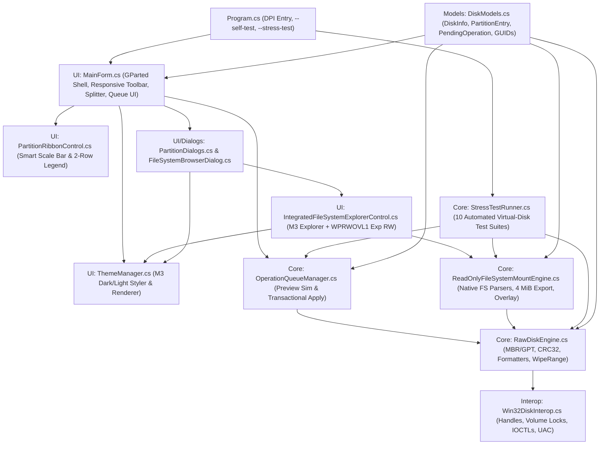

# WinParted Architecture & Technical Reference

This document explains how **WinParted** is structured, how its raw storage, native filesystem, operation queue, security/wipe, and desktop UI subsystems work together, and how to extend the codebase safely.

---

## 1. Build System, Binaries & Windows XP 32-bit Support

WinParted compiles directly via [`build.ps1`](build.ps1) with zero external NuGet dependencies ([`WinParted.csproj`](WinParted.csproj) targets `.NET Framework 3.5` / `x86` for IDE compatibility):

- **Compiler Script**: [`build.ps1`](build.ps1) compiles all sources under `src\` directly with `csc.exe`:
  - `Invoke-Xp35Build` (`/noconfig /nostdlib /platform:x86` against `Framework\v2.0.50727\*.dll` + `v3.5\System.Core.dll`) -> `bin\WinParted-XP-x86.exe` and `bin\WinParted-x86.exe` (CLR `v2.0.50727` `.NET 3.5 SP1` native binaries for Windows XP 32-bit SP2/SP3, PE Subsystem Version `4.0`).
  - `Invoke-TargetBuild` (`Framework64\v4.0.30319\csc.exe`) -> `bin\WinParted-x64.exe` (`x64`) and `bin\WinParted.exe` (`AnyCPU`).
  - [`src/app.config`](src/app.config) is copied beside the CLR 2.0 x86 executables (`WinParted-XP-x86.exe.config` and `WinParted-x86.exe.config`) with `<supportedRuntime version="v2.0.50727" />` followed by `<supportedRuntime version="v4.0" />`, allowing the XP x86 binaries to launch cleanly on both Windows XP (`.NET 3.5 SP1`) and modern Windows (`.NET 4.x`) while leaving the `.NET 4.x` `WinParted-x64.exe` and `WinParted.exe` targets free of a CLR 2.0 override config.
- **Windows XP 32-bit Runtime Compatibility Layer**:
  - **OS & P/Invoke Guards**: `Win32DiskInterop.IsWindowsVistaOrNewer`, `IsWindowsXpOrOlder`, and `Is64BitOperatingSystem()` (`IsWow64Process` inside `[MethodImpl(MethodImplOptions.NoInlining)]`) keep Vista+ entry points (`SetProcessDPIAware`, `dwmapi.dll` `DwmSetWindowAttribute`) out of JIT resolution on Windows XP.
  - **Legacy Disk Geometry & GPT Fallback**: `QueryDiskFromHandle` falls back from `IOCTL_DISK_GET_DRIVE_GEOMETRY_EX` to `IOCTL_DISK_GET_DRIVE_GEOMETRY` (`0x00070000`) + `IOCTL_DISK_GET_LENGTH_INFO` (`0x0007405C`), retries 512-byte sector-aligned reads when 4K alignment exceeds legacy CHS track boundaries, and runs userspace `RawDiskEngine.ParseDiskPartitionTable` whenever XP 32-bit's `disk.sys` returns a `0xEE` protective MBR partition for a GPT disk.
  - **Legacy `diskpart.exe` Raw Fallback**: `OperationQueueManager.ExecutePhysicalDiskOperation` automatically falls back to direct raw table/filesystem header updates on XP when `diskpart.exe` lacks `format`, `shrink`, `convert gpt`, or removable-drive support.
- **Non-Blocking Progress & Async Execution**: `OperationQueueManager.ApplyAll` streams `OperationProgressReport` events (sub-stage, live byte counts, throughput in `MiB/s`, async `diskpart.exe` output lines) into `ApplyOperationsProgressDialog` running on a background worker thread so the WinForms UI remains responsive.
- **Framework References**: `System.dll`, `System.Core.dll`, `System.Drawing.dll`, `System.Windows.Forms.dll`.
- **Source vs. Releases Policy**: Compiled executables (`bin/`, `*.exe`, `*.dll`, `*.pdb`) are git-ignored and excluded from source branches. Local developer builds compile into `bin\` on demand, while pre-built release binaries are published exclusively on the GitHub Releases page.
- **Strict .NET 3.5 / C# 5.0 Constraints**: Code must compile under both `v4.0.30319` C# 5.0 syntax **and** `.NET 3.5` (`CLR v2.0.50727`) API surface:
  - Do **not** use string interpolation (`$"..."`), null-conditional (`?.`), expression-bodied members, inline `out var`, `nameof(...)`, or pattern matching.
  - Do **not** use .NET 4.0+ APIs (`IReadOnlyList<T>`, `ConditionalWeakTable<,>`, 3+-arg `Path.Combine`, `Stopwatch.Restart()`, `Environment.Is64BitOperatingSystem`, `string.Join(sep, IEnumerable<string>)`, `using` on `RNGCryptoServiceProvider`, or `EventHandler<NonEventArgs>`).

---

## 2. Layered Architecture & Source Inventory

The codebase under [`src/`](src/) is divided into four strict layers plus the entrypoint:

### Source File Inventory

| File | Primary Responsibility |
| :--- | :--- |
| [`build.ps1`](build.ps1) | Compiles `src\**\*.cs` into local git-ignored `bin\WinParted-x86.exe`, `bin\WinParted-x64.exe`, and `bin\WinParted.exe`. |
| [`src/Program.cs`](src/Program.cs) | Configures `SetProcessDPIAware()`, executes `--self-test` / `--stress-test` CLI modes, or starts `MainForm`. |
| [`src/Models/DiskModels.cs`](src/Models/DiskModels.cs) | Domain models (`DiskInfo`, `PartitionEntry`, `PendingOperation`, `WipePattern`), `FileSystemType` (27 enum values), `GptPartitionTypeGuids`, `FileSystemColors`, and `ByteFormatter`. |
| [`src/Interop/Win32DiskInterop.cs`](src/Interop/Win32DiskInterop.cs) | Win32 P/Invoke (`CreateFile`, `DeviceIoControl`), physical disk & bus enumeration, volume-to-disk extent mapping, UAC elevation helpers, volume locking (`OpenAndLockVolumeNoDismount`), and fallback partition writes. |
| [`src/Core/RawDiskEngine.cs`](src/Core/RawDiskEngine.cs) | Unified `ReadBytes`/`WriteBytes` abstraction, on-demand demo/blank virtual `.img` creation (none auto-generated at startup), MBR/GPT parsing & CRC32 validation, superblock identification, native formatters (`Populate*`), and `WipeRange` (`ZeroFill`, `OnesFill`, `RandomDoD`). |
| [`src/Core/OperationQueueManager.cs`](src/Core/OperationQueueManager.cs) | Baseline vs. simulated preview state, boot-disk protection vs. non-system/USB editing, pre-enqueue validation, per-disk undo, virtual `.img` transactional rollback, hybrid physical execution (`diskpart.exe` + raw writes), and overlay/cache purge hooks. |
| [`src/Core/ReadOnlyFileSystemMountEngine.cs`](src/Core/ReadOnlyFileSystemMountEngine.cs) | Native userspace mounts for Ext2/3/4, APFS, HFS+/HFSX, Btrfs, XFS, ISO9660, plus `WPROFS01`/metadata catalogs, 4 MiB chunked streaming export, `WPRWOVL1` experimental RW overlay (head or isohybrid tail), and physical host shadow fallback. |
| [`src/Core/StressTestRunner.cs`](src/Core/StressTestRunner.cs) | Automated 10-suite safety and filesystem verification harness executing solely against temporary virtual `.img` files in `%TEMP%`. |
| [`src/UI/ThemeManager.cs`](src/UI/ThemeManager.cs) | Material Design 3 dark/light color tokens, Fibonacci/proportional spacing helpers, DWM dark titlebar integration, `M3ToolStripRenderer`, and tag-driven recursive styling. |
| [`src/UI/PartitionRibbonControl.cs`](src/UI/PartitionRibbonControl.cs) | GParted-style graphical disk strip with Smart Scale (`bytes^0.30`) vs. Linear Scale toggle, used-space bars, unallocated diagonal hatching, and 1-to-2 row wrapping legend strip. |
| [`src/UI/IntegratedFileSystemExplorerControl.cs`](src/UI/IntegratedFileSystemExplorerControl.cs) | File explorer control (`TreeView` + multi-mode `ListView` + preview pane + background 4 MiB chunked exporter with progress/cancellation + red Experimental Write sidebar shown exclusively inside explorer windows). |
| [`src/UI/MainForm.cs`](src/UI/MainForm.cs) | GParted-layout main window with responsive 1-to-2 row action toolbar, dynamic exact-fit `Drive:` selector, width-resizable Device Overview (`_deviceSplitter`), partition table grid, Pending Operations Queue, and demo `.img` generator menu action. |
| [`src/UI/Dialogs/PartitionDialogs.cs`](src/UI/Dialogs/PartitionDialogs.cs) | `CreateOrResizePartitionDialog` (interactive drag `SliderPreviewPanel`), `ManageFlagsDialog`, `WipePartitionDialog`, `HexSectorInspectorDialog`, and `AlignmentAndHealthDialog`. |
| [`src/UI/Dialogs/FileSystemBrowserDialog.cs`](src/UI/Dialogs/FileSystemBrowserDialog.cs) | Standalone modal Form wrapper hosting `IntegratedFileSystemExplorerControl` for browsing unsupported filesystems. |

---

## 3. Core Subsystems & Data Flow

### 3.1 Storage Abstraction, Locking & OS Boot Safety (`RawDiskEngine` + `Win32DiskInterop`)

Every core module reads and writes strictly through `RawDiskEngine.ReadBytes(disk, offset, length)` and `RawDiskEngine.WriteBytes(disk, offset, data)`:

1. **Virtual Disk Images (`disk.IsVirtualImage == true`)**: Backed by raw `.img` / `.vhd` files via `FileStream` at exact byte offsets without requiring Administrator elevation. No demo `.img` file is bundled or auto-created at startup; users generate or open images on demand via `GParted -> Create / Reset Demo Virtual Disk (.img)`, `Open Virtual Disk Image...`, or `New Blank Virtual Disk...`.
2. **Physical Drives (`disk.IsVirtualImage == false`)**: Backed by `Win32DiskInterop`:
   - `EnumeratePhysicalDisks()` queries `\\.\PhysicalDriveN` geometry (`IOCTL_DISK_GET_DRIVE_GEOMETRY_EX`), flags the active Windows OS/boot disk (`IsSystemDisk`), and maps mounted volumes (`IOCTL_VOLUME_GET_VOLUME_DISK_EXTENTS`).
   - `WriteRawDiskSectors()` acquires exclusive volume locks (`FSCTL_LOCK_VOLUME`) across overlapping volumes (`OpenAndLockVolumeNoDismount`) **without** calling `FSCTL_DISMOUNT_VOLUME` before `WriteFile` — preventing `\FileSystem\RAW` handles on Linux/USB ISO installers from returning `ERROR_INVALID_FUNCTION` (Win32 error `1`). It attempts writes through (a) the covering volume handle, (b) `\Device\HarddiskN\PartitionP`, and (c) `\\.\PhysicalDriveN` (clearing `DISK_ATTRIBUTE_READ_ONLY` via `IOCTL_DISK_SET_DISK_ATTRIBUTES` and enforcing 4K Read-Modify-Write alignment), falling back to dismount/offline retry only if needed.
3. **OS Boot Disk vs. USB Installer Boot Editing**:
   - Destructive operations targeting the live running Windows OS drive (`disk.IsSystemDisk && !disk.IsVirtualImage`) or its protected `IsSystemOrBoot` partitions are blocked at both `Enqueue()` time and execution time so Windows cannot saw off its own boot branch.
   - Removable USB drives and non-system secondary disks (`!disk.IsSystemDisk`), including USB boot sectors, EFI System Partitions (`ESP`), MBR active partitions, and full-drive `CreatePartitionTable` wipes/reformats, remain **fully editable** once locked.

### 3.2 Operation Queue, Preview Simulation & Secure Wipe (`OperationQueueManager`)

All partition table edits are queued cleanly before touching any media:

1. **Preview Pipeline**: `_baselineDisks` retains the last committed physical/virtual layout. `GetPreviewDisk(diskNumber)` clones the baseline `DiskInfo`, replays every queued `PendingOperation` for that disk via `ApplyOperationToModel`, and calls `RenumberPartitions`. `Enqueue(op)` validates on a disposable clone first to reject overlaps, out-of-bounds GPT LBAs, MBR 4-primary limits, or shrinking below `UsedBytes`.
2. **Commit & Rollback**:
   - **Virtual Disk (`ExecuteVirtualDiskOperation`)**: Snapshots primary (first 34 sectors) and backup (last 33 sectors) table regions before moving payloads, writing superblocks, or updating GPT/MBR headers. Any exception restores the snapshot; afterward `VerifyDiskPartitionTableIntegrity()` re-checks MBR bounds and primary/backup GPT CRC32 values.
   - **Physical Disk (`ExecutePhysicalDiskOperation`)**: Dispatches native Windows formatting/partitioning via `diskpart.exe` scripts (`BuildDiskPartScript`), and performs raw partition/header operations (ext2/3/4, APFS, HFS+/HFS, Btrfs, XFS, F2FS, ZFS, SquashFS, ISO9660, UDF, FAT16, Linux Swap, LVM2, in-place wipes/relabels) via `PreparePartitionForRawWrite()` + `RawDiskEngine`.
3. **Secure Wipe & Overlay/Cache Purging**:
   - `WipePartition` executes `RawDiskEngine.WipeRange(...)` using `WipePattern.ZeroFill`, `WipePattern.OnesFill`, or `WipePattern.RandomDoD` (cryptographic `RNGCryptoServiceProvider` fill across the partition range).
   - Every destructive commit (`WipePartition`, `FormatPartition`, `DeletePartition`, `CreatePartitionTable`, `RestorePartitionTable`) and demo reset calls `ReadOnlyFileSystemMountEngine.PurgeDiskOverlaysAndCache(diskNumber)` so on-disk `WPRWOVL1` tables, host shadow overlay files, and in-memory `ActiveMounts` are erased alongside the medium — preventing stale cached files from reappearing in the explorer.

### 3.3 Native Userspace Filesystem Parsers & Streaming Copy (`ReadOnlyFileSystemMountEngine`)

`MountReadOnly(disk, part)` constructs an in-memory `MountedReadOnlyVolume` (`VirtualFsNode` tree) without kernel filesystem drivers:

1. **Apple APFS (`ParseApfsVolume` + `ApfsOmapReader`)**:
   - Supports both APFS Container superblocks (`NXSB` at `+0x20`) and direct APFS Volume superblocks (`APSB`).
   - Validates 64-bit APFS Fletcher-64 block checksums (`ComputeApfsFletcher64` / `VerifyApfsFletcher64`).
   - Scans the container checkpoint descriptor ring (`CollectApfsNxsbCandidates`) sorted by descending transaction ID (`o_xid`) so stale block `0` checkpoints do not mask newer valid states.
   - Resolves 2-level Container `OMAP` B-Trees (`ResolveApfsVolumesFromContainer`) and per-volume `OMAP` B-Trees (`ApfsOmapReader`) at `o_xid` boundaries to map virtual object IDs to physical blocks.
   - Walks multi-level FS-Tree B-Trees (`CollectApfsFsTreeNodes`), decoding `APFS_TYPE_INODE` (`recType=3`), hashed/unhashed `APFS_TYPE_DIR_REC` (`recType=9`), `APFS_TYPE_FILE_EXTENT` (`recType=8` including multi-extent clone `private_id` indirection and sparse zero-holes mapped as `ContentOffset == -1`), and `APFS_TYPE_XATTR` (`recType=4`) for symlinks (`com.apple.fs.symlink`) and inline `com.apple.decmpfs` compression (literal `0xFF` and zlib `0x78` inflate via `TryDecompressZlibSlice`).
   - Merges multiple volumes inside a container (`FinalizeMountedApfsTree` + `MergeApfsEmptyDirectories`) such as macOS firmlinked `Macintosh HD` + `Macintosh HD - Data` trees while preferring non-internal volumes in `TryReadApfsVolumeMetadata` for UI labeling and used-space reporting.
2. **Apple HFS+ / HFSX (`ParseHfsPlusVolume`)**: Big-Endian Volume Header at `+0x400` (including Classic HFS `BD` wrapper unwrapping), Catalog B-Tree traversal, and **Extents Overflow B-Tree** resolution for multi-extent files exceeding 8 inline fork descriptors (verified on >16 MiB macOS `.dmg` payloads).
3. **Linux Ext2 / Ext3 / Ext4 (`ParseExtVolume`)**: Superblock (`0xEF53`) at `+1024`, Block Group Descriptor Table, root inode `2`, direct/indirect block pointers (`i_block[0..12]`), and Ext4 extent B-trees (`0xF30A`, `ParseExt4ExtentNode`).
4. **Linux Btrfs (`ParseBtrfsVolume`)**: Superblock `_BHRfS_M` at `+0x10040`, `sys_chunk_array` chunk tree mapping, Root Tree & FS Tree lookup (`5`), and B-tree leaf decoding for `INODE_ITEM`, `DIR_ITEM`/`DIR_INDEX`, and `EXTENT_DATA`.
5. **Linux XFS (`ParseXfsVolume`)**: Big-Endian `XFSB` superblock (`+0x00`), allocation-group relative inode translation, shortform `IN` directories, `XD2B`/`XDB3` block directories, and 128-bit BMBT extent records.
6. **Optical ISO9660 (`ParseIso9660Volume`)**: Primary Volume Descriptor (`CD001` at `+0x8000`), Joliet Supplementary Volume Descriptor (`+0x8800`), recursive ECMA-119 directory extents (`ParseIsoDirectoryExtent`), and Rock Ridge `NM` filenames.
7. **Structured Catalog / Superblock Mount (`ParseCatalogOrMetadataVolume`)**: Native superblock inspection + optional `WPROFS01` catalog for ReFS, F2FS, OpenZFS, SquashFS, UDF, Classic HFS, Linux Swap, and LVM2.

**4 MiB Chunked Streaming Export (`CopyFileNodeToStream`)**:
Large files (including multi-gigabyte disk images and macOS `.dmg` files) stream directly from disk extents (synthesizing zero bytes cleanly for APFS sparse `-1L` holes and decompressing inline buffers where applicable) in **4 MiB (`4,194,304 B`) chunks** to host `FileStream`s with live progress callbacks and cancellation support.

### 3.4 Experimental Write Overlay (`WPRWOVL1`), Isohybrid Tail Placement & Shadow Fallback

Inside `IntegratedFileSystemExplorerControl` (and only inside file explorer windows), users can enable the opt-in **Experimental Write Mode** (`ExperimentalToggle`) to create folders, upload files, or delete entries inside unsupported filesystems:

- **Safe Candidate Offset Selection (`GetCandidateOverlayTableRelOffsets`)**: Normally writes the 16 KiB `WPRWOVL1` directory/tombstone header at partition `+0x20000` (payload data starting at `+0x24000+`). If `+0x20000..+0x100000` overlaps an embedded partition — common on **isohybrid Linux USB installers** where an `ISO9660` image wraps a nested EFI System Partition (`ESP`) at low LBAs — `OverlapsOtherPartition` detects the collision and places `WPRWOVL1` cleanly in a non-overlapping **tail region** inside the partition.
- **Physical Host Shadow Fallback (`WriteOverlayRegionBytes` + `GetHostShadowOverlayFilePath`)**: On virtual `.img` disks, overlays always write directly in-image. On live physical drives (such as read-only flash controllers or non-elevated tests), if direct raw sector writes throw `Win32Exception` / `UnauthorizedAccessException` / `IOException`, WinParted transparently persists `WPRWOVL1` to a deterministic host shadow file (`%LocalAppData%\WinParted\ExperimentalOverlays\ovl_d<N>_<offset>_<fnv1a64>.bin`) and merges it seamlessly during future mounts until wiped or purged.

---

## 4. On-Disk Superblock, Partition Table & Metadata Reference

All offsets below are byte offsets relative to the **start of the partition** unless marked **Disk-relative**:

| Structure / FS | Magic / Signature & Offset | Endianness | GPT Type GUID (`GptPartitionTypeGuids`) | Reader & Formatter Support |
| :--- | :--- | :--- | :--- | :--- |
| **MBR / Protective MBR** | `0x55AA` @ Disk `+0x1FE`, 4x16B entries @ `+0x1BE` | LE | — | Full read/write/validate (editable on non-OS/USB disks) |
| **Primary / Backup GPT** | `"EFI PART"` @ LBA 1 (`+512`) & Last LBA, 128 entries | LE | CRC32 header + array | Full read/write/CRC32 validation & Backup GPT recovery |
| **NTFS** | `"NTFS    "` @ `+0x03`, Serial @ `+0x48`; hints `WPL:` / `WPU:` | LE | `BasicData` (`ebd0a0a2-...`) | Inspect, format (`diskpart`/header), relabel, move/resize |
| **FAT32 / EFI** | `"FAT32   "` @ `+0x52`, VolID @ `+0x43`, Label @ `+0x47` | LE | `BasicData` / `EfiSystem` | Inspect, format, relabel, move/resize |
| **FAT16** | `"FAT16   "` @ `+0x36`, VolID @ `+0x27`, Label @ `+0x2B` | LE | `BasicData` | Inspect, format, relabel, move/resize |
| **exFAT** | `"EXFAT   "` @ `+0x03`, Serial @ `+0x64` | LE | `BasicData` | Inspect, format, move/resize |
| **ReFS** | `"ReFS\0\0\0\0"` @ `+0x03`, Serial @ `+0x38`, UTF-16LE label @ `+0x40` | LE | `BasicData` | Inspect, format (`WPROFS01`), relabel, RO mount |
| **BitLocker** | `"-FVE-FS-"` @ `+0x03` | LE | `BasicData` | Detection & safe byte move |
| **Ext2 / Ext3 / Ext4** | `0xEF53` @ `+0x438`; compat `+0x45C`; incompat `+0x460`; UUID `+0x468`; Label `+0x478` | LE | `LinuxFilesystem` (`0fc63daf-...`) | Native RO mount (BGDT/inodes/extents), format (`PopulateExtDirectoryTree`), resize, relabel |
| **Btrfs** | `"_BHRfS_M"` @ `+0x10040`, `root` @ `+0x50`, `sys_chunk_array` @ `+0x32B` | LE | `LinuxFilesystem` | Native RO mount (B-tree + CRC32C), format (`PopulateBtrfsFsTree`), relabel |
| **XFS** | `"XFSB"` @ `+0x00`, `sb_blocksize` @ `+4`, `sb_dblocks` @ `+8`, `sb_rootino` @ `+56` | BE | `LinuxFilesystem` | Native RO mount (`IN`/BMBT/`XD2B`), format (`PopulateXfsFsTree`), relabel |
| **F2FS** | `0xF2F52010` @ `+0x400`, blocks @ `+0x424`, UUID @ `+0x46C`, UTF-16LE label @ `+0x47C` | LE | `LinuxFilesystem` | Inspect, format (`WPROFS01`), relabel, RO mount |
| **OpenZFS (`ZFS`)** | `"ZFS_POOL"` metadata @ `+0x0800`; Uberblock `0x00BAB10C` @ `+0x11000` | LE | `ZfsMember` (`6a898cc3-...`) | Inspect, format (`WPROFS01`), relabel, RO mount |
| **SquashFS** | `0x73717368` (`"hsqs"`) @ `+0x00`, inodes @ `+4`, block_size @ `+12`, bytes_used @ `+40` | LE | `LinuxFilesystem` | Inspect, format (`WPROFS01`), relabel, RO mount |
| **ISO9660** | `PVD[0]=1`, `"CD001"` @ `+0x8001` (Joliet SVD @ `+0x8800`) | Dual/BE+LE | `BasicData` | Native RO mount (ECMA-119 + Rock Ridge `NM`), format (`PopulateIso9660DirectoryTree`), relabel |
| **UDF** | `"BEA01"` @ `+0x8001`, `"NSR02"`/`"NSR03"` @ `+0x8801` / `+0x9001`, `"TEA01"` | LE | `BasicData` | Inspect, format (`WPROFS01`), relabel, RO mount |
| **Linux Swap** | `"SWAPSPACE2"` @ `+4086`, UUID @ `+0x40C`, Label @ `+0x41C` | LE | `LinuxSwap` (`0657fd6d-...`) | Inspect, format, relabel, RO mount |
| **LVM2** | `"LABELONE"` @ `+512` | LE | `LinuxLvm` (`e6d6d379-...`) | Inspect, format, RO mount |
| **Apple APFS** | `"NXSB"` / `"APSB"` @ `+0x20` (Fletcher-64 @ `+0x00`) | LE | `AppleApfs` (`7c3457ef-...`) | Full native RO mount (checkpoint ring, OMAP/FS-Tree B-Trees, `decmpfs`, firmlinks), format (`PopulateApfsContainerBTree`), relabel |
| **Apple HFS+ / HFSX** | `"H+"` / `"HX"` @ `+0x400` (or embedded inside `BD` wrapper) | BE | `AppleHfs` (`48465300-...`) | Native RO mount (Catalog + Extents Overflow B-Trees), format (`PopulateHfsPlusCatalogBTree`), resize, relabel |
| **Classic HFS** | `"BD"` @ `+0x400` | BE | `AppleHfs` | Inspect, format (`WPROFS01`), resize, relabel, RO mount |
| **WinParted Overlays** | `WPROFS01` @ `+0x3000`; `WPRWOVL1` @ `+0x20000` (or isohybrid tail) | LE | — | Synthetic catalog + persistent experimental RW overlay + shadow fallback |

---

## 5. UI Layout & Material Design 3 Theme System

### `ThemeManager` (`src/UI/ThemeManager.cs`)
Because Windows Forms lacks CSS stylesheets, `ThemeManager.ApplyTheme(Control root)` walks every child control recursively (alongside `ContextMenuStrip` via `ApplyContextMenu`), applying Material Design 3 dark/light palettes, DWM dark window chrome, rounded button painting, `SplitContainer` / `Splitter` theming, and `M3ToolStripRenderer` / `M3ColorTable`. Controls opt into semantic roles via `.Tag`:
- **Buttons**: `"PrimaryButton"`, `"TonalButton"`, `"DangerButton"`, `"ElevateButton"`, `"KeepButtonSize"`
- **CheckBox**: `"ExperimentalToggle"` (high-contrast red RW mode switch inside the file explorer)
- **Labels**: `"ExperimentalLabel"`, `"KeepForeColor"`
- **Panels**: `"SurfacePanel"`, `"ElevatedPanel"`, `"ContainerHighPanel"`, `"StatusBar"`, `"SliderPanel"`, `"ExperimentalPanel"`, `"ExperimentalHeaderPanel"`
- **TextBox**: `"ConsoleColors"` (preserves fixed monospace hex/log styling)
- **ToolStripItem**: `"ApplyHighlight"`, `"KeepForeColor"`

### Responsive Desktop Layout (`MainForm` + `PartitionRibbonControl`)
- **Action Toolbar & Dynamic `Drive:` Selector (`MainForm.cs`)**:
  - `UpdateDriveSelectorLayout()` measures the longest drive `DisplayName` (`TextRenderer.MeasureText`) and expands `_driveRightPanel` up to that exact width (and no wider) so full device names and capacities display cleanly.
  - When the window narrows below single-row capacity, `_driveRightPanel` keeps as much width as possible while `SyncToolbarLayout()` compresses `_mainToolStrip` into **two horizontal rows** (`Height = 74px`), expanding back to a compact **single row** (`Height = ThemeManager.F55`) on wider windows. Deferred updates run safely via `QueueSyncToolbarLayout()` (`BeginInvoke`).
- **Width-Resizable Device Overview**: `_deviceInfoPanel` pairs with a draggable vertical `_deviceSplitter` (`MinSize = 150`, `MinExtra = 320`) inside `_mainSplit.Panel1`, dynamically reflowing wrapped device metadata lines as the user resizes it.
- **Partition Ribbon (`PartitionRibbonControl.cs`)**: Renders proportional slices (`bytes^0.30` in Smart Scale vs. linear proportions), hatched unallocated regions, used-space bars, and a bottom filesystem legend that automatically compresses onto **two horizontal rows** (`legendRows == 2`) when window width is limited.
- **Pending Operations Header**: `_opsQuickFlow` (`FlowDirection.LeftToRight` + `SyncOpsQuickFlowWidth()`) keeps **Apply**, **Undo**, and **Clear** completely unclipped alongside `"Pending Operations Queue"`.

---

## 6. Automated 10-Suite Test Harness & Developer Cookbook

### Built-In Automated Stress Suites (`StressTestRunner.cs`)
Every suite executes solely on temporary virtual disks in `%TEMP%` (`--self-test`, `--stress-test`, or `Tools -> Run Stress & Data-Safety Test Suite...`):

| Suite | Verification Scope |
| :--- | :--- |
| **Stress 1** | Multi-disk switching (4 disks, 60 rapid switches), ribbon selection memory, and interleaved operation queues. |
| **Stress 2** | Windows filesystems (`NTFS`, `FAT32`, `exFAT`) grow, shrink, overlapping moves, UUID, and payload integrity. |
| **Stress 3** | Linux filesystems (`Ext4`, `Btrfs`, `XFS`, `LinuxSwap`) grow, shrink, overlapping moves, relabeling, and payload integrity. |
| **Stress 4** | Cross-disk partition clone + target expansion retaining 100% payload fidelity on both source and destination. |
| **Stress 5** | Pre-enqueue/pre-write safety guardrails (overlaps, GPT LBA bounds, shrink below used, MBR 4-slot limit) and Backup GPT recovery. |
| **Stress 6** | Apple filesystems (`APFS`, `HFS+`, `Classic HFS`) detection, GPT GUIDs, relabeling, and move/resize payload preservation. |
| **Stress 7** | Physical USB Ext4 formatting script generation (`diskpart`), MBR/GPT partition type IDs, and superblock reload verification. |
| **Stress 8** | Multi-OS read-only mounting, **advanced APFS** (checkpoint ring, 2-level OMAP & FS-Tree, clone extents, sparse holes, zlib `decmpfs`, dual-volume merge), **>16 MiB HFS+ Extents Overflow**, native Btrfs/XFS/Ext2/ISO9660 & dev FS export/overlay persistence. |
| **Stress 9** | Running OS boot disk protection vs. non-system USB boot sector editing, full-drive MBR/GPT reformatting, and isohybrid tail `WPRWOVL1` overlay selection. |
| **Stress 10** | Secure Wipe (`ZeroFill`, `OnesFill`, `RandomDoD` byte-entropy checks), Reformat, and Demo Reset overlay/shadow/RAM cache purge completeness. |

### Developer Cookbook

#### Adding a New Filesystem
1. **Model**: Add the enum value to `FileSystemType`, colors/display name in `FileSystemColors`, and GPT GUID in `GptPartitionTypeGuids.ForFileSystem` inside [`src/Models/DiskModels.cs`](src/Models/DiskModels.cs).
2. **MBR Type ID**: Update `Win32DiskInterop.GuessFsFromMbrType` in [`src/Interop/Win32DiskInterop.cs`](src/Interop/Win32DiskInterop.cs) and `RawDiskEngine.GetDefaultMbrType` in [`src/Core/RawDiskEngine.cs`](src/Core/RawDiskEngine.cs).
3. **Inspect / Format / Relabel / Resize**: Update `InspectPartitionSuperblock`, `WriteFileSystemHeader`, and `UpdateFileSystemLabelInPlace` / `ResizeFileSystemInPlace` in [`src/Core/RawDiskEngine.cs`](src/Core/RawDiskEngine.cs).
4. **Read-Only Explorer**: Register in `IsSupportedNonMicrosoftFs` and implement a parser in `MountReadOnly` inside [`src/Core/ReadOnlyFileSystemMountEngine.cs`](src/Core/ReadOnlyFileSystemMountEngine.cs).
5. **UI & Hex Inspector**: Wire menus/dialogs in [`src/UI/MainForm.cs`](src/UI/MainForm.cs) / [`src/UI/Dialogs/PartitionDialogs.cs`](src/UI/Dialogs/PartitionDialogs.cs) and sector decode hints in `HexSectorInspectorDialog`.
6. **Verify**: Add coverage in [`src/Core/StressTestRunner.cs`](src/Core/StressTestRunner.cs), run `build.ps1`, and execute `--stress-test` on both `x64` and `x86`.

#### Adding a New Queued Operation Type
1. Add the enum value to `OperationType` and fields to `PendingOperation` in [`src/Models/DiskModels.cs`](src/Models/DiskModels.cs).
2. Implement simulated state validation/mutation in `OperationQueueManager.ApplyOperationToModel`.
3. Implement execution in `ExecuteVirtualDiskOperation` (with rollback) and `ExecutePhysicalDiskOperation`.
4. Wire into [`src/UI/MainForm.cs`](src/UI/MainForm.cs) via `TryEnqueue(...)` and verify with a suite case in [`src/Core/StressTestRunner.cs`](src/Core/StressTestRunner.cs).
