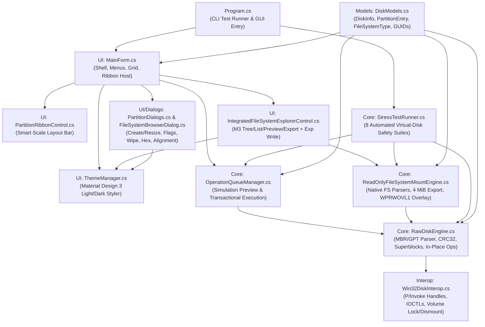

# WinParted Architecture & Developer Guide

This document explains how **WinParted** is organized, how its disk, filesystem, queue, and UI subsystems interact, and how to extend the codebase safely.

---

## 1. Build System & Language Constraints

WinParted compiles directly against `.NET Framework 4.8` without MSBuild, Visual Studio `.sln`/`.csproj` files, or external NuGet packages.

- **Compiler Script**: [`build.ps1`](build.ps1) (`Invoke-TargetBuild`) locates Windows' built-in `csc.exe`:
  - `C:\Windows\Microsoft.NET\Framework\v4.0.30319\csc.exe` -> `bin\WinParted-x86.exe` (32-bit x86)
  - `C:\Windows\Microsoft.NET\Framework64\v4.0.30319\csc.exe` -> `bin\WinParted-x64.exe` and `bin\WinParted.exe` (64-bit x64)
- **Framework References**: `System.dll`, `System.Core.dll`, `System.Drawing.dll`, `System.Windows.Forms.dll`.
- **C# 5.0 Syntax Rule**: Because `v4.0.30319\csc.exe` ships a C# 5.0 compiler, **newer C# syntax will fail the build**:
  - Do **not** use string interpolation (`$"..."`) -> use `string.Format(...)`.
  - Do **not** use null-conditional (`?.`), expression-bodied members (`=>` properties/methods), inline `out var`, `nameof(...)`, or pattern matching (`is Type x`).
  - Use explicit `delegate` / lambda bodies, `string.Format`, and temporary `out` variables.

---

## 2. Layered Component Architecture

The source tree under [`src/`](src/) is organized into four strict layers plus the entrypoint:



### Source Inventory

| File | Primary Responsibility |
| :--- | :--- |
| [`build.ps1`](build.ps1) | Compiles `src\**\*.cs` into `bin\WinParted-x86.exe`, `bin\WinParted-x64.exe`, and `bin\WinParted.exe`. |
| [`src/Program.cs`](src/Program.cs) | Sets DPI awareness, parses `--self-test` / `--stress-test` CLI flags, or launches `MainForm`. |
| [`src/Models/DiskModels.cs`](src/Models/DiskModels.cs) | Core domain models (`DiskInfo`, `PartitionEntry`, `PendingOperation`), `FileSystemType` (27 enum values), `GptPartitionTypeGuids`, `FileSystemColors`, `ByteFormatter`. |
| [`src/Interop/Win32DiskInterop.cs`](src/Interop/Win32DiskInterop.cs) | Win32 P/Invoke (`CreateFile`, `DeviceIoControl`), physical drive enumeration, volume-to-disk mapping, UAC elevation helpers, volume lock/dismount + partition fallback writes. |
| [`src/Core/RawDiskEngine.cs`](src/Core/RawDiskEngine.cs) | Unified `ReadBytes`/`WriteBytes` abstraction (`FileStream` for `.img`, sector-aligned Win32 handles for physical drives), MBR/GPT parsing & CRC32 validation, superblock identification & synthetic/native formatting (`Populate*`). |
| [`src/Core/OperationQueueManager.cs`](src/Core/OperationQueueManager.cs) | Baseline vs. simulated preview state, pre-enqueue safety checks, per-disk undo, virtual `.img` rollback execution, and hybrid physical execution (`diskpart.exe` + raw sector writes). |
| [`src/Core/ReadOnlyFileSystemMountEngine.cs`](src/Core/ReadOnlyFileSystemMountEngine.cs) | Userspace native filesystem mounting (`VirtualFsNode`, `MountedReadOnlyVolume`), 4 MiB chunked `CopyFileNodeToStream`, search/export to host, and opt-in `WPRWOVL1` experimental write overlay. |
| [`src/Core/StressTestRunner.cs`](src/Core/StressTestRunner.cs) | Automated 8-suite test harness running strictly against temporary virtual `.img` files. |
| [`src/UI/ThemeManager.cs`](src/UI/ThemeManager.cs) | Material Design 3 light/dark color tokens, `M3ToolStripRenderer`, and tag-driven recursive styling. |
| [`src/UI/PartitionRibbonControl.cs`](src/UI/PartitionRibbonControl.cs) | GParted-style graphical partition ribbon with hover tooltips, unallocated hatching, mount badges, and non-linear Smart Scale. |
| [`src/UI/IntegratedFileSystemExplorerControl.cs`](src/UI/IntegratedFileSystemExplorerControl.cs) | Embedded M3 file explorer (`TreeView` + multi-mode `ListView` + preview pane + background 4 MiB export progress bar + red Experimental Write sidebar). |
| [`src/UI/MainForm.cs`](src/UI/MainForm.cs) | Main desktop shell coordinating menus, toolbars, drive switcher, partition grid, queue view, and embedded explorer binding. |
| [`src/UI/Dialogs/PartitionDialogs.cs`](src/UI/Dialogs/PartitionDialogs.cs) | `CreateOrResizePartitionDialog` (with interactive drag `SliderPreviewPanel`), `ManageFlagsDialog`, `WipePartitionDialog`, `HexSectorInspectorDialog`, and `AlignmentAndHealthDialog`. |
| [`src/UI/Dialogs/FileSystemBrowserDialog.cs`](src/UI/Dialogs/FileSystemBrowserDialog.cs) | Standalone modal Form wrapper around `IntegratedFileSystemExplorerControl`. |

---

## 3. Core Subsystems & Data Flow

### 3.1 Dual Storage Abstraction (`RawDiskEngine` + `Win32DiskInterop`)

Every core parser and formatter operates solely through `RawDiskEngine.ReadBytes(disk, offset, length)` and `RawDiskEngine.WriteBytes(disk, offset, data)`:
- **Virtual Disks (`disk.IsVirtualImage == true`)**: Backed by raw `.img` files via `FileStream`. All byte offsets are exact file offsets, requiring no Administrator privileges.
- **Physical Disks (`disk.IsVirtualImage == false`)**: Backed by `Win32DiskInterop`:
  1. `EnumeratePhysicalDisks()` queries `\\.\PhysicalDriveN` geometry (`IOCTL_DISK_GET_DRIVE_GEOMETRY_EX`) and maps drive letters/GUID volumes via `FindFirstVolume`/`IOCTL_VOLUME_GET_VOLUME_DISK_EXTENTS`.
  2. `ReadRawDiskSectors()` aligns reads to `LogicalSectorSize` (typically 512 B or 4096 B).
  3. `WriteRawDiskSectors()` acquires exclusive volume locks (`FSCTL_LOCK_VOLUME`) across all mounted/overlapping volumes on the target disk (`OpenAndLockVolumeNoDismount`) **without** sending `FSCTL_DISMOUNT_VOLUME` before `WriteFile` — critical for `\FileSystem\RAW` handles on Linux/ISO installer partitions, where premature dismount sets `VCB_STATE_FLAG_DISMOUNTED` and rejects writes with Win32 error `1` (`ERROR_INVALID_FUNCTION`). It keeps those locks held while trying (1) the covering volume handle, (2) `\Device\HarddiskN\PartitionP`, and (3) `\\.\PhysicalDriveN` (clearing `DISK_ATTRIBUTE_READ_ONLY` via `IOCTL_DISK_SET_DISK_ATTRIBUTES` and enforcing 4K Read-Modify-Write sector alignment + chunked retry), only dismounting/offlining as a final retry.

### 3.2 Non-Destructive Queue & Simulated Preview (`OperationQueueManager`)

Like GParted, edits are **queued rather than executed immediately**:
1. `_baselineDisks` stores the last committed physical/virtual state.
2. `GetPreviewDisk(diskNumber)` clones the baseline `DiskInfo` and sequentially replays `ApplyOperationToModel(preview, op)` followed by `RenumberPartitions(preview)`.
3. UI controls (`_ribbon`, `_gridPartitions`, `_deviceInfoPanel`) always render the **preview** state, while `UndoLast()` / `UndoLastForDisk(diskNumber)` remove queued actions without touching disk bytes.
4. `Enqueue(op)` runs `ApplyOperationToModel` on a disposable clone first to reject invalid state (overlapping partitions, out-of-bounds GPT LBAs, MBR 4-slot exhaustion, shrinking below `UsedBytes`, or mutating active Windows `IsSystemOrBoot` partitions).

When the user clicks **Apply All Operations**:
- **Virtual Disk (`ExecuteVirtualDiskOperation`)**: Takes a snapshot of the primary (first 34 sectors) and backup (last 33 sectors) header regions before applying payload copies/moves, superblock updates, and `WritePartitionTable`. Any exception restores the snapshot; afterward `VerifyDiskPartitionTableIntegrity()` re-reads and checks all MBR bounds and primary/backup GPT CRC32 checksums.
- **Physical Disk (`ExecutePhysicalDiskOperation`)**: Requires `Win32DiskInterop.IsAdministrator()`. Uses `diskpart.exe` scripts (`BuildDiskPartScript`) for native Windows NTFS/FAT32/exFAT/ReFS partitioning & formatting, and uses `PreparePartitionForRawWrite()` + `RawDiskEngine.WriteFileSystemHeader()` / `UpdateFileSystemLabelInPlace()` / `WipeRange()` for foreign filesystems (ext2/3/4, Btrfs, XFS, F2FS, ZFS, SquashFS, ISO9660, UDF, FAT16, APFS, HFS+, HFS, LinuxSwap, LVM2).

### 3.3 Userspace Read-Only Mounting & 4 MiB Streaming Export (`ReadOnlyFileSystemMountEngine`)

`MountReadOnly(disk, part)` dispatches based on `part.FileSystem`:
1. **Ext2 / Ext3 / Ext4 (`ParseExtVolume`)**: Reads the superblock at `+1024`, Block Group 0 Descriptor Table, and root inode `2`. Resolves both legacy direct `i_block[0..11]` / single-indirect `i_block[12]` pointers and Ext4 extent B-trees (`0xF30A`).
2. **HFS+ / HFSX (`ParseHfsPlusVolume`)**: Reads Big-Endian Volume Header at `+0x400` (unwrapping Classic HFS `BD` containers when embedded), parses Catalog B-Tree header/index/leaf nodes plus the Extents Overflow B-Tree (`extExtents`) so files exceeding 8 inline fork extents retain complete multi-extent sector lists.
3. **Btrfs (`ParseBtrfsVolume`)**: Reads superblock `_BHRfS_M` at `+0x10040`, parses `sys_chunk_array` (`+0x32B`) for logical-to-physical chunk translation, locates Root Tree (`root`), FS Tree (object ID `5`), and walks B-tree internal/leaf nodes for `INODE_ITEM (1)`, `DIR_ITEM (84)` / `DIR_INDEX (96)`, and inline/regular `EXTENT_DATA (108)`.
4. **XFS (`ParseXfsVolume`)**: Reads Big-Endian `XFSB` superblock (`+0x00`), converts 64-bit AG/relative inode addresses to partition byte offsets, and parses `IN` (`0x494E`) shortform directories and `XD2B`/`XDB3` extent-based directory blocks + 128-bit BMBT extent records.
5. **ISO9660 (`ParseIso9660Volume`)**: Reads Primary Volume Descriptor (`CD001` at `+0x8000`) and optional Joliet Supplementary Volume Descriptor (`+0x8800`), recursively traversing ECMA-119 directory extents with Rock Ridge `NM` name extraction.
6. **Metadata / Structured Catalog (`ParseCatalogOrMetadataVolume`)**: Summarizes superblock fields for F2FS, ZFS, SquashFS, UDF, ReFS, APFS, Classic HFS, Linux Swap, and LVM2, parses an embedded `WPROFS01` catalog at `+0x3000` if formatted by WinParted, or exposes a synthetic superblock summary file.

**Multi-GB Copy Architecture (`CopyFileNodeToStream`)**:
Previously, loading an entire file into a single `byte[]` truncated or failed on multi-GB files (such as a `1.6 GB` macOS `BaseSystem.dmg`). `CopyFileNodeToStream` now iterates across `ContentExtents` (or contiguous `ContentOffset` + `ContentLength`) in **4 MiB (`4,194,304 B`) chunks** (`CopyStreamChunkBytes`), writing directly into the host `FileStream` while reporting live progress and checking cancellation flags.

### 3.4 Experimental Write Overlay (`WPRWOVL1`) & Host Shadow Fallback

Because full in-place B-tree/journal mutation on foreign volumes is high-risk, `ReadOnlyFileSystemMountEngine` provides an opt-in overlay table gated behind the red toggle (`ExperimentalToggle`) in `IntegratedFileSystemExplorerControl`:
- **Overlay Header (`+0x20000`, 16 KiB)**: ASCII magic `WPRWOVL1`, next payload offset (`>= +0x24000`), record count, and variable-length records (`Op=1` upsert file/directory, `Op=2` tombstone delete, `RelDataOffset`, `DataLength`, `ModifiedUtcTicks`, UTF-8 `FullPath`).
- **Load/Merge**: Whenever `MountReadOnly()` opens a partition, `LoadAndMergeExperimentalOverlay()` reads `+0x20000` (checking any host shadow file for physical disks first) and overlays any persisted creates, uploads, overwrites, or deletions onto the native read-only tree.
- **Physical Host Shadow Fallback**: If a physical drive/USB controller or non-elevated session blocks raw sector writes (`Win32Exception`, `UnauthorizedAccessException`, `IOException`), `WriteOverlayRegionBytes` falls back cleanly to a deterministic shadow overlay file in `%LocalAppData%\WinParted\ExperimentalOverlays\ovl_d<N>_<offset>_<fnv1a64>.bin`, marks `OverlayUsingHostShadow = true` (`[EXP-RW SHADOW]`), and streams reads/exports transparently from the shadow file. Virtual `.img` disks never use the shadow fallback and always persist directly in-image.

---

## 4. On-Disk Superblock, Partition Table & Metadata Reference

All offsets below are byte offsets relative to the **start of the partition** unless marked **Disk-relative**:

| Structure / FS | Magic / Signature & Offset | Endianness | GPT Type GUID (`GptPartitionTypeGuids`) | Reader & Formatter Support |
| :--- | :--- | :--- | :--- | :--- |
| **MBR / Protective MBR** | `0x55AA` @ Disk `+0x1FE`, 4x16B entries @ `+0x1BE` | LE | — | Full read/write/validate |
| **Primary / Backup GPT** | `"EFI PART"` @ LBA 1 (`+512`) & Last LBA, 128 entries | LE | CRC32 header + array | Full read/write/CRC32/recovery |
| **NTFS** | `"NTFS    "` @ `+0x03`, Serial @ `+0x48`; custom hints `WPL:` @ `+0x1A0`, `WPU:` @ `+0x1C0` | LE | `BasicData` (`ebd0a0a2-...`) | Inspect, format header, relabel, move/resize |
| **FAT32 / EFI** | `"FAT32   "` @ `+0x52`, VolID @ `+0x43`, Label @ `+0x47` | LE | `BasicData` / `EfiSystem` | Inspect, format header, relabel, move/resize |
| **FAT16** | `"FAT16   "` @ `+0x36`, VolID @ `+0x27`, Label @ `+0x2B` | LE | `BasicData` | Inspect, format, relabel, move/resize |
| **exFAT** | `"EXFAT   "` @ `+0x03`, Serial @ `+0x64` | LE | `BasicData` | Inspect, format header, move/resize |
| **ReFS** | `"ReFS\0\0\0\0"` @ `+0x03`, Serial @ `+0x38`, UTF-16LE label @ `+0x40` | LE | `BasicData` | Inspect, format (`WPROFS01`), relabel, RO mount |
| **BitLocker** | `"-FVE-FS-"` @ `+0x03` | LE | `BasicData` | Detection & safe byte move |
| **Ext2 / Ext3 / Ext4** | `0xEF53` @ `+0x438`; compat `+0x45C` (`0x04` Ext3); incompat `+0x460` (`0x40`/`0x200` Ext4); UUID `+0x468`; Label `+0x478` | LE | `LinuxFilesystem` (`0fc63daf-...`) | Native RO mount (BGDT/inodes/extents), format (`PopulateExtDirectoryTree`), resize, relabel |
| **Btrfs** | `"_BHRfS_M"` @ `+0x10040`, `root` @ `+0x50`, `sys_chunk_array` @ `+0x32B` | LE | `LinuxFilesystem` | Native RO mount (B-tree + CRC32C), format (`PopulateBtrfsFsTree`), relabel |
| **XFS** | `"XFSB"` @ `+0x00`, `sb_blocksize` @ `+4`, `sb_dblocks` @ `+8`, `sb_rootino` @ `+56`, `sb_fdblocks` @ `+144` | BE | `LinuxFilesystem` | Native RO mount (`IN`/BMBT/`XD2B`), format (`PopulateXfsFsTree`), relabel |
| **F2FS** | `0xF2F52010` @ `+0x400`, blocks `@+0x424`, UUID `@+0x46C`, UTF-16LE label `@+0x47C` | LE | `LinuxFilesystem` | Inspect, format (`WPROFS01`), relabel, RO mount |
| **OpenZFS (`ZFS`)** | `"ZFS_POOL"` metadata `@+0x0800`; Uberblock `0x00BAB10C` `@+0x11000` | LE | `ZfsMember` (`6a898cc3-...`) | Inspect, format (`WPROFS01`), relabel, RO mount |
| **SquashFS** | `0x73717368` (`"hsqs"`) @ `+0x00`, inodes `@+4`, block_size `@+12`, bytes_used `@+40`, label `@+0x80` | LE | `LinuxFilesystem` | Inspect, format (`WPROFS01`), relabel, RO mount |
| **ISO9660** | `PVD[0]=1`, `"CD001"` @ `+0x8001` (Joliet SVD `@+0x8800`) | Dual/BE+LE | `BasicData` | Native RO mount (ECMA-119 + Rock Ridge `NM`), format (`PopulateIso9660DirectoryTree`), relabel |
| **UDF** | `"BEA01"` @ `+0x8001`, `"NSR02"`/`"NSR03"` @ `+0x8801` / `+0x9001`, `"TEA01"` | LE | `BasicData` | Inspect, format (`WPROFS01`), relabel, RO mount |
| **Linux Swap** | `"SWAPSPACE2"` @ `+4086`, UUID `@+0x40C`, Label `@+0x41C` | LE | `LinuxSwap` (`0657fd6d-...`) | Inspect, format, relabel, RO mount |
| **LVM2** | `"LABELONE"` @ `+512` | LE | `LinuxLvm` (`e6d6d379-...`) | Inspect, format, RO mount |
| **Apple APFS** | `"NXSB"` / `"APSB"` @ `+32` | LE | `AppleApfs` (`7c3457ef-...`) | Inspect, format (`WPROFS01`), relabel, RO mount |
| **Apple HFS+ / HFSX** | `"H+"` / `"HX"` @ `+0x400` (or embedded inside `BD` wrapper) | BE | `AppleHfs` (`48465300-...`) | Native RO mount (Catalog + Extents Overflow B-Trees), format (`PopulateHfsPlusCatalogBTree`), resize, relabel |
| **Classic HFS** | `"BD"` @ `+0x400` | BE | `AppleHfs` | Inspect, format (`WPROFS01`), resize, relabel, RO mount |
| **WinParted Overlays** | `WPROFS01` catalog `@+0x3000` (data `@+0x4000+`); `WPRWOVL1` Exp RW table `@+0x20000` (data `@+0x24000+`) | LE | — | Synthetic catalog + persistent experimental write overlay |

---

## 5. Material Design 3 UI Architecture & Theme System

### `ThemeManager` (`src/UI/ThemeManager.cs`)
WinForms lacks CSS variables, so `ThemeManager.ApplyTheme(Control root)` walks every child control recursively (alongside `ContextMenuStrip` via `ApplyContextMenu`) and applies Google Material Design 3 dark/light surface roles (`BackPrimary`, `BackSurface`, `BackElevated`, `BackContainerHigh`, `BackInput`, `BackSelection`, `BackHover`, `TonalButtonBack/Fore`) plus `M3ToolStripRenderer` / `M3ColorTable`.

Controls opt into semantic M3 roles by setting `Control.Tag` (or `ToolStripItem.Tag`) to one of the exact strings below:
- **Buttons**: `"PrimaryButton"`, `"TonalButton"`, `"DangerButton"`, `"ElevateButton"`
- **CheckBox**: `"ExperimentalToggle"` (high-visibility red experimental switch)
- **Labels**: `"ExperimentalLabel"`, `"KeepForeColor"`
- **Panels**: `"SurfacePanel"`, `"ElevatedPanel"`, `"ContainerHighPanel"`, `"StatusBar"`, `"SliderPanel"`, `"ExperimentalPanel"`, `"ExperimentalHeaderPanel"`
- **TextBox**: `"ConsoleColors"` (preserves fixed monospace hex/log styling)
- **ToolStripItem**: `"ApplyHighlight"` (green emphasis for Apply button), `"KeepForeColor"`

### `PartitionRibbonControl` (`src/UI/PartitionRibbonControl.cs`)
Draws the horizontal disk slice strip. When **Smart Scale** is checked, widths use `Math.Pow(p.PartitionLength, 0.30)` bounded by a `30 px` minimum slice width so tiny EFI/MSR/unallocated slices remain clickable alongside multi-terabyte partitions.

### `IntegratedFileSystemExplorerControl` (`src/UI/IntegratedFileSystemExplorerControl.cs`)
- Docked inside `MainForm` (auto-mounts virtual disk partitions when clicked; shows an explicit **Mount Read-Only** button for physical disks so live drives aren't probed unexpectedly).
- Combines a directory `TreeView`, navigation bar (Back/Forward/Up/path jump + Details/Large Icons/List view selector + live recursive search), right-side preview pane, background-threaded 4 MiB export with a `100 ms`-throttled progress bar + Cancel button, and the collapsible red Experimental Write sidebar.

---

## 6. Developer Cookbook

### How to Add a New Filesystem
1. **Model**: Add the enum member in `FileSystemType`, its M3 fill/border/used colors + `GetDisplayName` in `FileSystemColors`, and its GPT type GUID mapping in `GptPartitionTypeGuids.ForFileSystem` inside [`src/Models/DiskModels.cs`](src/Models/DiskModels.cs).
2. **MBR Fallback**: Update `Win32DiskInterop.GuessFsFromMbrType` in [`src/Interop/Win32DiskInterop.cs`](src/Interop/Win32DiskInterop.cs) and `RawDiskEngine.GetDefaultMbrType` in [`src/Core/RawDiskEngine.cs`](src/Core/RawDiskEngine.cs).
3. **Inspection / Formatting / Relabeling / Resizing**: Add superblock signature detection to `RawDiskEngine.InspectPartitionSuperblock`, formatter logic to `WriteFileSystemHeader`, and (if supported) `UpdateFileSystemLabelInPlace` / `ResizeFileSystemInPlace`.
4. **Userspace Read-Only Mount**:
   - Add the `FileSystemType` to `ReadOnlyFileSystemMountEngine.IsSupportedNonMicrosoftFs` in [`src/Core/ReadOnlyFileSystemMountEngine.cs`](src/Core/ReadOnlyFileSystemMountEngine.cs).
   - Either add a dedicated native tree parser in `MountReadOnly` (like `ParseBtrfsVolume`/`ParseXfsVolume`) or add a superblock summary branch in `ParseCatalogOrMetadataVolume`.
5. **UI Pickers & Hex Decoder**: Add the filesystem to format/create dropdowns in [`src/UI/MainForm.cs`](src/UI/MainForm.cs) / [`src/UI/Dialogs/PartitionDialogs.cs`](src/UI/Dialogs/PartitionDialogs.cs) and sector decoder hints in `HexSectorInspectorDialog.DecodeSectorStructure`.
6. **Test**: Add format -> detect -> mount -> search -> export -> experimental write assertions in [`src/Core/StressTestRunner.cs`](src/Core/StressTestRunner.cs) (`VerifyDevFileSystemsMountAndFormat` or a dedicated check) and run:
   ```powershell
   powershell -ExecutionPolicy Bypass -File .\build.ps1
   .\bin\WinParted-x64.exe --self-test
   .\bin\WinParted-x86.exe --self-test
   ```

### How to Add a New Queued Operation Type
1. Add the enum value to `OperationType` and any fields to `PendingOperation` in [`src/Models/DiskModels.cs`](src/Models/DiskModels.cs).
2. Implement simulated state mutation in `OperationQueueManager.ApplyOperationToModel` so `Enqueue()` validates it and `GetPreviewDisk()` renders it accurately.
3. Implement execution in `OperationQueueManager.ExecuteVirtualDiskOperation` (virtual `.img` with rollback) and `ExecutePhysicalDiskOperation` / `BuildDiskPartScript` (physical drives).
4. Wire the menu/toolbar action in [`src/UI/MainForm.cs`](src/UI/MainForm.cs) through `TryEnqueue(...)` and add a stress test case in [`src/Core/StressTestRunner.cs`](src/Core/StressTestRunner.cs).
